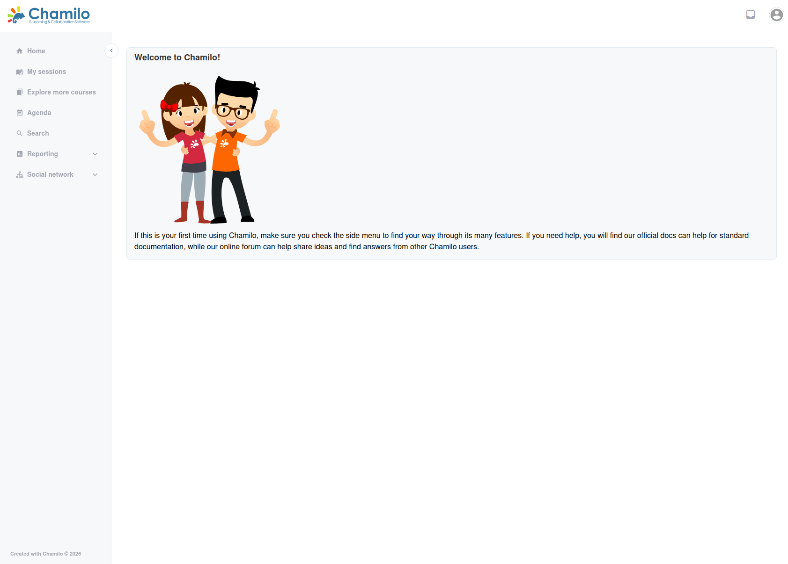
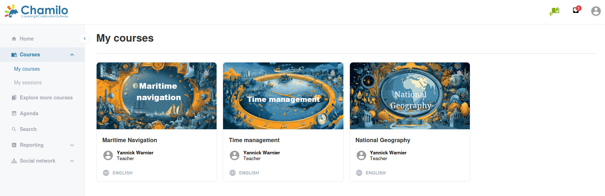

# Aan de slag

Deze sectie helpt u vertrouwd te raken met Chamilo 3.0. U leert hoe u zich aanmeldt, door de hoofdinterface navigeert en uw profiel configureert.

## Aanmelden

Om toegang te krijgen tot Chamilo opent u uw browser en gaat u naar de URL die door uw instelling is verstrekt (bijvoorbeeld `https://chamilo.yourschool.edu`). Voer uw gebruikersnaam en wachtwoord in op de aanmeldpagina en klik op **Aanmelden**.

Als uw instelling externe authenticatie gebruikt (zoals Azure, Keycloak of een single sign-on-systeem van de universiteit), ziet u mogelijk extra aanmeldknoppen onder het standaardaanmeldformulier. Klik op de juiste knop om u te authenticeren via de identiteitsprovider van uw instelling.

> Als u uw wachtwoord bent vergeten, klikt u op de koppeling **Wachtwoord vergeten?** op de aanmeldpagina. U ontvangt een e-mail met instructies om het opnieuw in te stellen.

## Eerste indruk

Na het aanmelden ziet u de startpagina van Chamilo. De interface is ingedeeld in drie hoofdgebieden:

* **Bovenbalk** — Toont het platformlogo, uw berichteninbox (met een badge die ongelezen berichten aangeeft) en uw gebruikersavatar. Klik op uw avatar om uw profiel en accountinstellingen te openen.
* **Zijbalk** — Het navigatiepaneel aan de linkerkant geeft u snel toegang tot uw cursussen, sessies, agenda, sociaal netwerk en meer. U kunt het samenvouwen door op de schakelaar aan de rand te klikken.
* **Hoofdinhoudsgebied** — Hier wordt de inhoud van de huidige pagina weergegeven. Op de startpagina ziet u systeemaankondigingen en uw uitgelichte cursussen.

## Uw cursussen

Klik in de zijbalk op **Mijn cursussen** om alle cursussen te zien waarvoor u als docent of student bent ingeschreven. Elke cursus verschijnt als een kaart met:

* De cursusafbeelding of miniatuur
* De cursustitel
* Snelle acties

Als uw instelling **sessies** (tijdsgebonden trainingsperioden) gebruikt, ziet u ook een koppeling **Mijn sessies** in de zijbalk, ingedeeld in huidige, afgelopen en komende sessies.

Sessies in Chamilo zijn een manier om dezelfde cursus op verschillende tijdstippen aan verschillende groepen cursisten aan te bieden, zonder de cursusinhoud te dupliceren. Beschouw een sessie als een geplande editie of cohort van een cursus. Meer over dit onderwerp volgt later.

## Volgende stappen

* [De interface begrijpen](understanding-the-interface.md) — Een gedetailleerde blik op elk onderdeel van de Chamilo-interface
* [Uw profiel](your-profile.md) — Hoe u uw persoonlijke gegevens en voorkeuren beheert
* [Democursussen](demo-courses.md) — De twee kant-en-klare cursussen (AI Act en Using Chamilo) die bij elke nieuwe installatie zijn inbegrepen