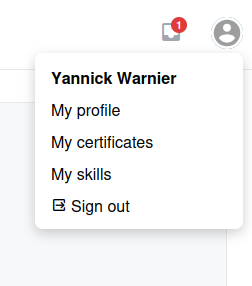

# Uw profiel

Uw profiel in Chamilo bevat uw persoonlijke gegevens en voorkeuren. Andere gebruikers op het platform kunnen delen van uw profiel zien, afhankelijk van uw zichtbaarheidsinstellingen.

## Uw profiel openen

Klik op uw **avatar** in de rechterbovenhoek van de bovenbalk en selecteer vervolgens **Profiel** in het vervolgkeuzemenu. U kunt het ook openen via de sectie **Sociaal netwerk** in de zijbalk.

## Profielgegevens

Op uw profielpagina kan het volgende worden weergegeven (afhankelijk van de configuratie):

* **Avatar** — Uw profielfoto. Klik op **Profiel bewerken** om deze te wijzigen.
* **Volledige naam** — Uw voor- en achternaam zoals geregistreerd op het platform.
* **E-mail** — Uw e-mailadres. Andere gebruikers kunnen erop klikken om u een bericht te sturen binnen Chamilo.
* **Taal** — Uw voorkeurstaal.
* **Extra velden** — Afhankelijk van de configuratie van uw platform kunt u velden zien zoals telefoonnummer, Skype-naam, LinkedIn-profiellink of aangepaste velden die door uw beheerder zijn gedefinieerd.

## Uw profiel bewerken

Om uw profielgegevens bij te werken, klikt u op **Profiel bewerken**. Hier kunt u:

* Uw naam, e-mailadres en wachtwoord wijzigen
* Uw avatar/foto uploaden of wijzigen
* Uw voorkeurstaal bijwerken
* Extra profielvelden invullen (Skype, LinkedIn, enz.)
* Meldingsvoorkeuren configureren

Om uw wachtwoord te wijzigen, klikt u op **Wachtwoord wijzigen**. Om veiligheidsredenen moet u uw huidige wachtwoord en uw nieuwe wachtwoord tweemaal opgeven.

Als uw beheerder de optie **tweefactorauthenticatie** (`2fa_enable`) voor het platform heeft ingeschakeld, kunt u via uw profiel 2FA inschakelen voor uw eigen account met een TOTP-authenticatorapp (Google Authenticator, Authy, 1Password, enz.). Zodra dit is ingeschakeld, vraagt de aanmeldprocedure naast uw wachtwoord om de tijdgebonden 6-cijferige code.

## Persoonsgegevens

Onder **Sociaal netwerk** > **Persoonsgegevens** kunt u alle informatie bekijken die Chamilo over u opslaat. Deze sectie bevat:

* Een overzicht van alle verzamelde gegevens, geordend per categorie
* Indien ingeschakeld door uw organisatie, uw acceptatiestatus voor de **Algemene voorwaarden** van het platform
* Indien ingeschakeld door uw organisatie, een optie om **uw toestemming in te trekken** of **account verwijderen**, waarmee een verzoek tot verwijdering van het account wordt gestart dat uw beheerder zal verwerken

> Deze functie is beschikbaar om te voldoen aan de regelgeving inzake gegevensbescherming. Neem contact op met uw beheerder als u vragen hebt over hoe uw gegevens worden behandeld.