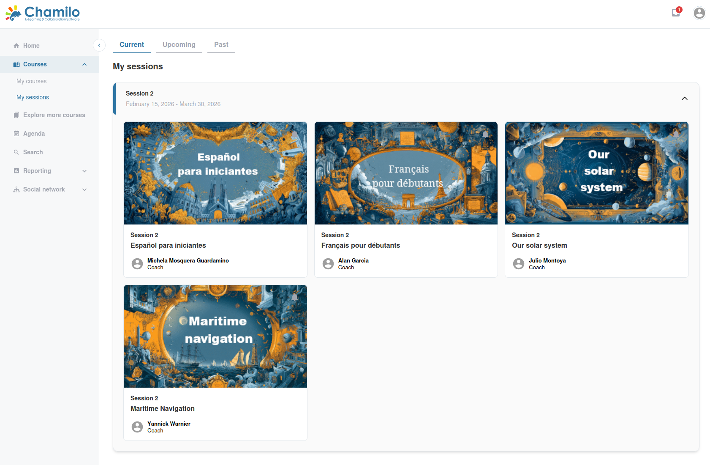

# Sessies

Sessies in Chamilo zijn een manier om dezelfde cursus op verschillende momenten aan verschillende groepen cursisten aan te bieden, zonder de cursusinhoud te dupliceren. Beschouw een sessie als een geplande editie of cohort van een cursus.

## Hoe sessies werken

Een **cursus** is een container van inhoud en tools. Een **sessie** wijst die cursus toe aan een specifieke groep cursisten voor een specifieke periode. Dit betekent:

* Dezelfde cursus kan in meerdere sessies worden hergebruikt
* Elke sessie heeft eigen ingeschreven cursisten en eigen begin- en einddatums
* Elke sessie heeft eigen resultaten — cijfers, voortgang en trackinggegevens worden per sessie gescheiden bewaard
* De basisinhoud van de cursus wordt gedeeld, maar docenten kunnen bepaalde elementen per sessie aanpassen

## Uw sessies

Klik in de zijbalk op **Mijn sessies** om uw sessies te bekijken. Ze zijn ingedeeld in drie weergaven:

* **Huidige sessies** — Sessies die momenteel actief zijn
* **Afgelopen sessies** — Sessies die zijn beëindigd
* **Aankomende sessies** — Sessies die nog niet zijn gestart

Elke sessie toont de cursussen die erin zitten. Klik op een cursus binnen een sessie om deze te openen.

## Lesgeven in een sessie

Wanneer u een cursus via een sessie opent, is de ervaring vergelijkbaar met een gewone cursus, met enkele verschillen:

* De **sessienaam** verschijnt naast de cursustitel, zodat u altijd weet in welke sessie u werkt
* Gegevens van cursisten (voortgang, cijfers, inzendingen) zijn specifiek voor deze sessie
* Sommige instellingen (zoals de mogelijkheid om de zichtbaarheid van tools te wijzigen) kunnen door de sessiebeheerder zijn vergrendeld

## Sessie-rollen

Sessies introduceren extra rollen:

| Rol | Beschrijving |
|------|-------------|
| **Sessiebeheerder** | Beheert het aanmaken en configureren van sessies |
| **Sessietutor** | Houdt toezicht op alle cursussen binnen een sessie (kan tracking over cursussen heen raadplegen) |
| **Cursustutor** | Geeft les in een specifieke cursus binnen een sessie |

Als u als **cursustutor** aan een sessie bent toegewezen, kunt u de inhoud van die cursus beheren en de voortgang van de cursisten van de sessie volgen.

> Sessies worden doorgaans beheerd door beheerders. Als u een sessie wilt aanmaken of wijzigen, neem dan contact op met uw platformbeheerder of sessiebeheerder.