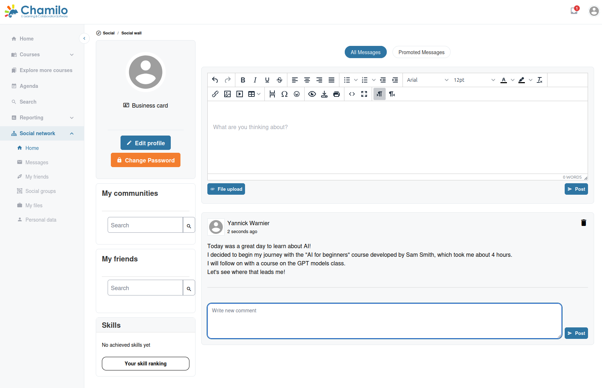

# Sociaal netwerk

Chamilo bevat een ingebouwd sociaal netwerk waarmee u verbinding kunt maken met andere gebruikers op het platform. Deze functie kan door uw platformbeheerder worden in- of uitgeschakeld.

## Het sociale netwerk openen

Klik op **Sociaal netwerk** in de zijbalk om de sociale functies te openen. Als u deze optie niet ziet, heeft uw beheerder deze mogelijk uitgeschakeld.

## Uw sociale muur

De sociale muur toont een feed met activiteit van u en uw connecties. U kunt:

* **Updates plaatsen** — Tekst en links delen met uw connecties
* **Liken en reageren** — Reageren op berichten van andere gebruikers
* **Activiteit bekijken** — Recente berichten zien van mensen met wie u verbonden bent

## Connecties

U kunt verbinding maken met andere gebruikers op het platform:

* **Gebruikers zoeken** — Collega's en cursisten op naam vinden
* **Verbindingsverzoeken versturen** — Andere gebruikers uitnodigen om verbinding te maken
* **Connecties beheren** — Verbindingen accepteren, weigeren of verwijderen

> **Opmerking:** Cursisten kunnen alleen andere cursisten zoeken en als vrienden toevoegen — zij kunnen geen vriendschapsverzoeken naar docenten sturen. Als docent kunt u echter wel cursisten zoeken en verzoeken om hen als vrienden toe te voegen.

## Berichten

Het sociale netwerk is geïntegreerd met het berichtensysteem van het platform:

* **Berichten versturen**  — Directe berichten schrijven aan andere gebruikers
* **Postvak IN**  — Ontvangen berichten lezen en beantwoorden
* **Verzonden berichten**  — Berichten bekijken die u hebt verzonden

### Berichten opstellen en beantwoorden

Bij het opstellen van een nieuw bericht kunt u dit in één keer aan meerdere ontvangers adresseren. Evenzo kunt u bij het beantwoorden van een bericht meerdere gebruikers in uw antwoord opnemen — handig voor groepscoördinatie zonder een formele sociale groep.

### E-mailantwoorden en openstatus

Als inkomende e-mailantwoorden door de beheerder zijn ingeschakeld, kunnen ontvangers van meldingen over directe berichten antwoorden vanuit hun e-mailclient; het antwoord wordt dan toegevoegd aan het gesprek in Chamilo. Het antwoord moet afkomstig zijn van het e-mailadres dat is geregistreerd op het Chamilo-account van de ontvanger.

Als het bijhouden van het openen van e-mail is ingeschakeld, kunnen uw **Verzonden berichten** ook een tijdstempel **E-mailmeldingen** tonen. Dit betekent alleen dat de trackingafbeelding van de melding is opgevraagd en bewijst niet dat het bericht is gelezen.

### Zwevende chat en één-op-één-videogesprekken

Het zwevende chatpaneel staat los van zowel het Postvak IN als de cursustool **Chat**. Selecteer een online contact om in realtime directe berichten uit te wisselen. Als de beheerder videochat heeft ingeschakeld en uw browser WebRTC ondersteunt, toont een online contact ook **Videogesprek starten**.

Gesprekken zijn één-op-één. De ontvanger kan een inkomend gesprek **Accepteren** of **Weigeren**. Tijdens een verbonden gesprek kan elke deelnemer de microfoon dempen of het dempen opheffen, de camera in- of uitschakelen en ophangen. De browser kan de eerste keer om toestemming voor camera en microfoon vragen.

### Berichtlabels

Als uw platformconfiguratie berichtlabels gebruikt (doorgaans beheerd op platformniveau), toont uw postvak IN een lijst met labels waarop u kunt klikken om berichten op dat label te filteren. Zo vindt u gerelateerde gesprekken sneller terug naarmate uw postvak IN groeit.

## Sociale groepen

Met sociale groepen kunnen gebruikers zich verzamelen rond gemeenschappelijke interesses of projecten:

* **Lid worden van groepen** — Bestaande groepen bekijken en eraan deelnemen
* **Groepen aanmaken** — Een nieuwe sociale groep starten (indien toegestaan)
* **Groepsdiscussies** — Berichten delen binnen de context van een groep

> Sociale groepen verschillen van **cursusgroepen** (behandeld in de sectie [Groepen](collaboration-and-communication/groups.md)). Cursusgroepen zijn gekoppeld aan een specifieke cursus, terwijl sociale groepen platformbreed zijn.