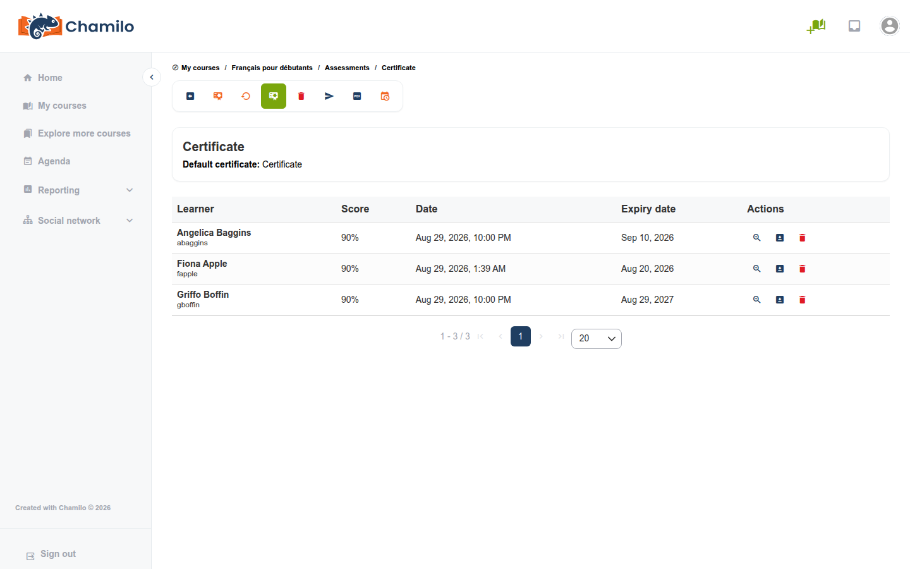
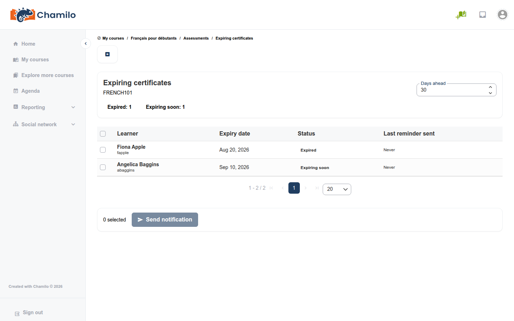
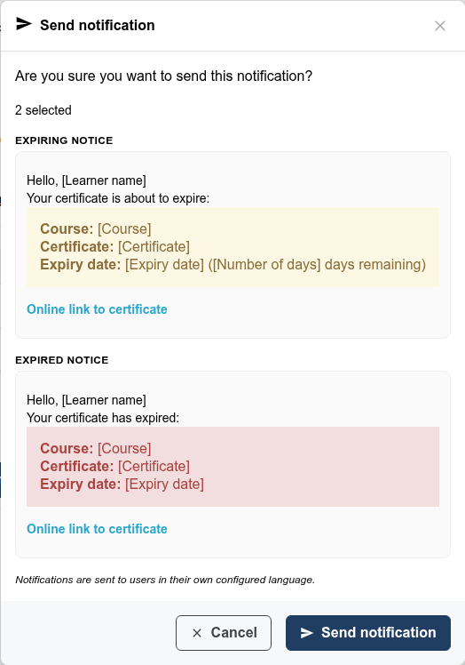

# Certificaten en vaardigheden

Met Chamilo kunt u certificaten toekennen aan cursisten die aan specifieke prestatiecriteria voldoen, en vaardigheden valideren die aan die prestaties zijn gekoppeld.

## Hoe certificaten werken

Certificaten zijn gekoppeld aan de **Beoordelingen** (ook wel Gradebook genoemd). Wanneer het cijfer van een cursist de door u gedefinieerde minimumdrempel bereikt of overschrijdt, wordt een certificaat beschikbaar om te downloaden.

De werkwijze is:

1. Stel de [Beoordelingen](../assessing-learners/gradebook.md) in met uw oefeningen, opdrachten en andere beoordeelde activiteiten
2. Definieer een **minimale certificeringsscore** (bijv. 70%)
3. Wanneer een cursist die score bereikt, kan hij of zij het certificaat downloaden (hetzij in de tool Beoordelingen zelf, hetzij vanuit een leerpad als u de laatste stap daarvoor hebt geconfigureerd). Als docent kunt u ook de actie **Certificaten genereren** in het cijferboek gebruiken om de PDF's in batch aan te maken voor alle in aanmerking komende cursisten.

## Certificaatsjablonen

Certificaten gebruiken sjablonen die door de platformbeheerder zijn gedefinieerd. Het sjabloon bevat doorgaans:

* De naam van de cursist
* De cursusnaam
* De voltooiingsdatum
* De behaalde score
* Een QR-code of URL voor online verificatie

De eerste keer dat u de certificaatsjabloonbeheerder opent voor de Beoordelingen van een cursus (het pictogram **Certificaat koppelen** in het cijferboek), dupliceert Chamilo automatisch het standaardcertificaatsjabloon van het platform naar de cursus, zodat u nooit op een lege pagina terechtkomt — de kopie is van u om vanaf daar vrij aan te passen. Als u het later loskoppelt (**In plaats daarvan het standaardcertificaat van het systeem gebruiken**), maakt het opnieuw openen van de beheerder het niet een tweede keer aan; alleen een cursus waaraan werkelijk nooit een certificaatdocument is gekoppeld, krijgt er automatisch een gegenereerd.

### Cursustracking-placeholders in sjablonen

Certificaatsjablonen kunnen tracking-placeholders bevatten naast de velden voor cursist, cursus en cijfer. De volgende placeholders worden ingevuld wanneer Chamilo een certificaat genereert:

| Placeholder | Waarde |
|-------------|-------|
| `((time_in_course))` | Tijd die de cursist in de cursus heeft doorgebracht voor de huidige cursus-/sessiecontext, opgemaakt als verstreken tijd. |
| `((time_in_course_in_all_sessions))` | Som van de bijgehouden tijd van de cursist voor deze cursus **over de sessies heen**. Het is een aggregaat over sessies en niet noodzakelijk gelijk aan de tijd van de huidige context. |
| `((start_date_and_end_date))` | Eerste en laatste verbindingsdatum met de cursus voor de huidige context. Als beide op één dag vallen, is het label het gelokaliseerde equivalent van **De [datum]**; anders is het **Van [eerste datum] tot [laatste datum]**. |

Deze waarden komen uit de cursisttracking en vertegenwoordigen **geregistreerde activiteit**, niet de geplande duur van de cursus of academische studie-uren. De tags voor verstreken tijd gebruiken nu de normale tijdopmaak van Chamilo, zonder de eerdere verkorte opmaak. Bekijk een voorbeeld van het gegenereerde certificaat met representatieve trackinggegevens, vooral wanneer een cursus in meerdere sessies wordt hergebruikt.

## Geldigheid en vervaldatum van certificaten

Certificaten kunnen zo worden ingesteld dat ze na een bepaald aantal dagen verlopen. In de instellingen van de [Beoordelingen](../assessing-learners/gradebook.md) voor de hoofdcategorie verschijnt, zodra **Certificaten genereren** is ingeschakeld, een veld **Geldigheid van het certificaat (dagen)**. Laat het op `0` (de standaardwaarde) staan voor certificaten die nooit verlopen, of stel een aantal dagen in zodat een certificaat dat aantal dagen na uitgifte verloopt.

De eigen vervaldatum van elk certificaat wordt automatisch berekend op basis van die instelling wanneer het wordt gegenereerd (of opnieuw gegenereerd) — u stelt deze niet certificaat voor certificaat in. De lijst **Certificaten** toont een kolom **Vervaldatum** voor elke cursist, met de tekst **Verloopt nooit** wanneer geen geldigheidsperiode van toepassing is.

Als voor de categorie geen geldigheidsperiode is geconfigureerd, kunt u nog steeds handmatig de vervaldatum van een individuele cursist instellen (of wijzigen): klik op de potloodknop **Vervaldatum bewerken** naast hun vermelding en kies een datum. Deze knop is alleen beschikbaar wanneer de categorie zelf geen geldigheidsperiode heeft — zodra een geldigheidsperiode is ingesteld, worden vervaldatums automatisch beheerd en kunnen ze niet langer certificaat voor certificaat worden bewerkt.

### Cursisten herinneren aan een naderende of verstreken vervaldatum

Open de lijst **Certificaten** voor uw beoordeling en klik op de knop **Verlopende certificaten**  om te zien van welke cursisten de certificaten zijn verlopen of binnenkort verlopen. De pagina toont per cursist: de **Vervaldatum** van het certificaat, de **Status** (**Verlopen** of **Verloopt binnenkort**) en wanneer een herinnering hierover **Laatste herinnering verzonden** is (of **Nooit**). Gebruik **Dagen vooruit** om te verbreden of te versmallen hoe ver in de toekomst "verloopt binnenkort" kijkt.

Om cursisten zelf te informeren:

1. Selecteer de cursisten die u wilt herinneren (of selecteer alles)
2. Klik op **Melding verzenden**
3. Bekijk het voorbeeld van de e-mail die wordt verzonden — afzonderlijke voorbeelden worden getoond voor de formulering "verloopt binnenkort" en "verlopen", afhankelijk van in welke categorie de geselecteerde cursisten vallen
4. Bevestig door in het dialoogvenster opnieuw op **Melding verzenden** te klikken

Elke cursist wordt geïnformeerd in de eigen ingestelde taal, zowel per e-mail als via een intern Chamilo-bericht. Opnieuw verzenden voor hetzelfde certificaat en dezelfde vervaldatum is veilig — Chamilo houdt bij wat al per certificaat is verzonden en stuurt een cursist geen dubbele herinneringen, tenzij u expliciet opnieuw verzendt.

Beheerders kunnen dezezelfde herinneringen ook automatisch plannen, op terugkerende basis, zonder dat een docent ze handmatig hoeft te activeren — zie [Instellingen voor cronjobs](../../admin-guide/platform-settings/crons-settings.md#certificate-expiry-reminders).

## Ondertekende certificaatreferenties (optioneel)

Wanneer de beheerder verificatie van ondertekende certificaten inschakelt, kunnen cursisten vanuit **Mijn certificaten** de publicatie van een verifieerbare referentie goedkeuren of intrekken. Na goedkeuring kan een beheerder de ondertekende referentie uitgeven en optioneel de vingerafdruk ervan verankeren op het Sepolia-testnet. Een openbare verificatielink controleert de handtekening van de referentie, de huidige toestemming, de intrekking en de status van het onderliggende certificaat; verankering op Sepolia is optioneel en gebruikt een testnetwerk.

Zie [Verificatie van ondertekende certificaten](../../admin-guide/maintenance/signed-certificate-verification.md) voor de workflow van de beheerder en belangrijke beperkingen rond toestemming.

## Certificaatsjablonen importeren uit ZIP-bestanden

U kunt een ZIP-pakket uploaden met een HTML-certificaatsjabloon en de bijbehorende afbeeldingen wanneer u een certificaat koppelt aan een cursusbeoordeling. Kies in de uploadweergave voor certificaatsjablonen een `.html`-bestand of een `.zip`-archief. Chamilo importeert het HTML-sjabloon en sluit ondersteunde afbeeldingsbestanden in, zodat het certificaat kan worden bekeken en gegenereerd zonder de uitgepakte afbeeldingen als openbare bestanden beschikbaar te stellen.

Het ZIP-bestand moet ten minste één `.html`- of `.htm`-bestand bevatten. HTML-sjablonen mogen in submappen staan; ondersteunde afbeeldingsformaten zijn PNG, JPEG, GIF en WebP. Andere bestandstypen, onveilige archiefpaden, symbolische koppelingen en te grote archieven worden geweigerd. Als een pakket meerdere sjablonen bevat, controleer dan de geïmporteerde documenten en selecteer het bedoelde certificaatsjabloon voordat u certificaten voor cursisten genereert.

Bekijk een certificaat met een testcursist voordat u in bulk genereert, vooral wanneer de opmaak verwijst naar relatieve afbeeldingspaden of placeholders voor cursusvoortgang. Zie [PR #9371 voor ZIP-import van certificaten](https://github.com/chamilo/chamilo-lms/pull/9371).

## Platformrapport voor verlopen certificaten

Portaalbeheerders hebben een rapport **Verlopen certificaten** in Globale rapportage. Het ondersteunt filtering op trefwoord, sessie, cursus, maand en jaar, en vermeldt de vervaldatum van elk overeenkomend certificaat. Dit verschilt van de herinneringsweergave **Verlopende certificaten** van de docent, hierboven beschreven. Zie [PR #9372 voor het globale rapport over verlopen certificaten](https://github.com/chamilo/chamilo-lms/pull/9372) en de [handleiding Globale statistieken](../../admin-guide/analytics/global-statistics.md).

## Vaardigheden

Vaardigheden vertegenwoordigen competenties die cursisten verwerven. In Chamilo:

* Vaardigheden kunnen worden gekoppeld aan prestaties in het cijferboek
* Wanneer een cursist een certificaat behaalt, worden eventuele bijbehorende vaardigheden automatisch gevalideerd
* Vaardigheden stapelen zich op in het profiel van de cursist en vormen zo een competentiedossier
* Vaardigheden kunnen hiërarchisch worden georganiseerd (bijv. "Data-analyse" onder "Onderzoeksmethoden")
* Vaardigheden kunnen verder worden beoordeeld door peers (360°-evaluatie)

---
## Certificaat- en vaardigheidsstatus bekijken

Als docent kunt u zien:

* Welke cursisten certificaten hebben behaald in uw cursus
* Welke vaardigheden zijn gevalideerd
* De voortgang van cursisten richting de certificeringsdrempel
* Welke certificaten zijn verlopen of binnenkort verlopen, en of er al een herinnering voor is verzonden

Cursisten kunnen hun eigen certificaten en gevalideerde vaardigheden bekijken via hun profiel, en kunnen het Skills Wheel raadplegen om te zien welke vaardigheden in hun organisatie gevraagd zijn.

Als uw platform academische transcripten gebruikt, wordt elk certificaat dat een cursist behaalt ook een regel in diens transcript, met de score en de letter van de beoordelingsschaal — zie [Academische transcripten](../../admin-guide/users/academic-transcripts.md).

## Tips

* **Stel duidelijke verwachtingen** — Vertel cursisten aan het begin van de cursus wat zij moeten bereiken om een certificaat te behalen
* **Gebruik betekenisvolle vaardigheidsnamen** — Vaardigheden moeten beschrijven wat de cursist kan, niet alleen de cursusnaam
* **Combineer met portfolio's** — Moedig cursisten aan hun certificaten aan hun portfolio toe te voegen
* **Breid certificaten uit** — Vraag uw beheerder de plugin [Custom Certificate](../plugins/custom-certificate.md) in te schakelen om nog meer mogelijkheden voor certificaatsjablonen te benutten
* **Stel een geldigheidsperiode in voor certificeringen die aan naleving zijn gebonden** — Als een certificering periodiek moet worden vernieuwd (bijv. veiligheidstraining), stel dan **Certificate validity (days)** in zodat cursisten een herinnering krijgen voordat deze vervalt