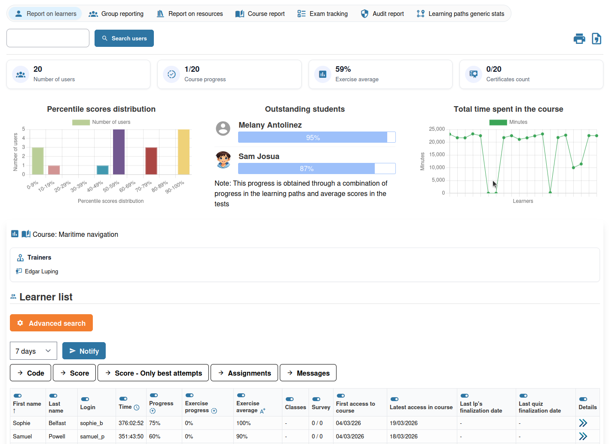

# Cursusrapporten

Cursusrapporten geven u een geaggregeerd overzicht van activiteit en prestaties van alle cursisten in uw cursus.

## Cursusrapporten openen

Open het hulpmiddel **Opvolging**  vanaf de cursushomepage en selecteer de weergave van rapporten op cursusniveau.

## Beschikbare rapporten

### Activiteitenoverzicht

Een samenvatting van de algemene betrokkenheid bij de cursus, inclusief ingeschreven cursisten, tijd besteed in de cursus, cursusvoortgang, voortgang van oefeningen en gemiddelde score, en opdrachtactiviteit.

Afzonderlijke detailweergaven zijn beschikbaar vanuit de opvolgingssectie voor **bronnen** (toegangsaantallen per bron), **hulpmiddelen** (gebruik per hulpmiddel) en **gebeurtenissen** (ruw gebeurtenissenlogboek).

### Oefeningenrapporten

Voor elke oefening in de cursus:

* Aantal cursisten dat de oefening heeft geprobeerd
* Gemiddelde score
* Scoreverdeling
* Aantal cursisten dat is geslaagd (op basis van de door u ingestelde slaaggrens)

### Leerpadrapporten

Voor elk leerpad:

* Voltooiingspercentages voor alle cursisten
* Gemiddeld voortgangspercentage
* Tijd besteed per item
* Cursisten die het pad hebben voltooid versus cursisten die nog bezig zijn

### Opdrachtrapporten

Voor elke opdracht:

* Aantal ontvangen inzendingen
* Aantal openstaande beoordelingen

## Gegevens exporteren

U kunt opvolgings- en rapportgegevens exporteren voor verdere analyse. Zoek de optie **Exporteren**  om gegevens te downloaden in een spreadsheetcompatibel formaat.

## Sessierapporten

Als u binnen een sessie lesgeeft, zijn rapporten beperkt tot de cursisten van die sessie. Sessietutoren hebben toegang tot rapporten van alle cursussen in hun sessie. Een globale configuratie-instelling kan docenten ook toestaan opdrachten te zien in alle sessies die hun cursus gebruiken (vraag dit na bij uw beheerder).