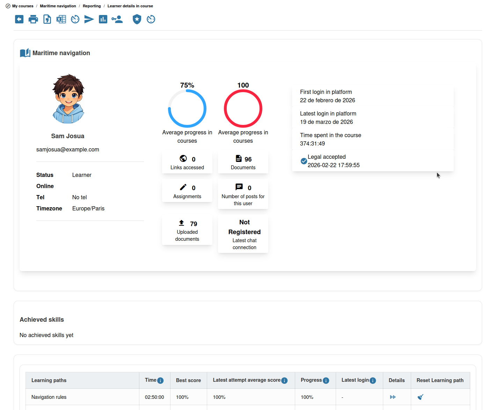

# Cursistopvolging

Chamilo volgt de activiteit van cursisten op het hele platform en geeft u gedetailleerd inzicht in hoe elke cursist met uw cursus omgaat.

## Toegang tot cursistopvolging

Open het hulpmiddel **Opvolging**  vanaf de startpagina van de cursus, of klik op **Rapportage** in de zijbalk.

## Wat wordt bijgehouden

Voor elke cursist registreert Chamilo (in de hoofdweergave per cursist):

* **Aanmeldactiviteit** — Wanneer de cursist voor het laatst is aangemeld en de totale aanmeldtijd
* **Tijd besteed in de cursus** — Totale tijd die de cursist in uw cursus heeft doorgebracht
* **Eerste en laatste toegang** — Wanneer de cursist de cursus voor het eerst betrad en voor het laatst bezocht
* **Cursusvoortgang** — Geaggregeerd voortgangspercentage over de cursus
* **Oefenresultaten** — Scores en pogingen voor elke oefening
* **Voortgang van het leerpad** — Voltooiingspercentage en tijd besteed aan elk leerpad
* **Inzendingen van opdrachten** — Welke opdrachten zijn ingediend en beoordeeld

Details over toegang per bron (welke specifieke documenten of pagina's een cursist heeft geopend) en activiteit op hulpmiddelniveau zijn beschikbaar via de speciale weergaven **Bronnen**, **Hulpmiddelen** en **Gebeurtenissen** in het opvolgingsgedeelte, en niet in de hoofdrij van de cursist.

## Individuele cursistgegevens bekijken

Klik op de naam van een cursist om het gedetailleerde activiteitenrapport te zien. Dit toont:

* Een samenvatting van de algehele betrokkenheid
* Voortgang door elk leerpad
* Oefenscores en pogingengeschiedenis
* Status van opdrachtinzendingen

## Cursistrapport over alle cursussen

**Rapportage** > **Cursisten**, vervolgens de gegevens van een cursist, opent het cursistrapport (`/reporting/learners/{id}`), dat elke cursus omvat die de cursist volgt. Onder het profiel en de verworven vaardigheden van de cursist toont het:

* **Klassen** — De klassen waartoe de cursist behoort, indien die er zijn
* **Cursussen** — De cursussen waarop de cursist rechtstreeks is ingeschreven
* **Eén tabel per sessie** — De titel en toegangsdatums van de sessie, gevolgd door de cursussen van de cursist in die sessie

Beheerders, personeelsmanagers, studentbazen en sessiebeheerders zien alle inschrijvingen van de cursist. Docenten, tutoren en coaches zien alleen de cursussen die zij doceren of begeleiden, de sessies die zij als algemene coach begeleiden, en de cursussen die zij in een sessie coachen; een cursusdocent ziet die cursus ook in de sessies van de cursist.

Datums worden weergegeven in de tijdzone van de gebruiker wanneer gebruikers er een mogen kiezen, anders in de tijdzone van het platform.

Elke cursustabel vermeldt de bestede tijd, voortgang, score, afwezigheden (gemiste presentielijsten van het totaal) en cijferlijstscore voor elke cursus, gevolgd door een rij **Totaal**. De cursustitel opent de cursus en de detailknop opent het rapport van de cursist in die cursus. Een cursus die zowel rechtstreeks als in een sessie wordt gevolgd, verschijnt in beide tabellen, met de cijfers van elke inschrijving.

Elke tabel kan afzonderlijk worden geëxporteerd naar CSV of Excel. Sessietabellen bieden ook een PDF-export van de aanwezigheid van de sessie en een **Certificaat van bekwaamheid**. De exportknoppen bovenaan de pagina exporteren alle tabellen tegelijk.

### Verworven vaardigheden

Het blok **Verworven vaardigheden** toont de vaardigheden die de cursist heeft verworven. Als u op een vaardigheid klikt, wordt de badge ervan geopend. Hoe de vaardigheden worden weergegeven, hangt af van twee instellingen van de categorie **Vaardigheden** in de platforminstellingen:

* Wanneer **Namen van vaardigheidsniveaus** (`skill.skill_levels_names`) leeg is, worden de verworven vaardigheden na elkaar weergegeven.
* Anders worden de vaardigheden in de vaardighedenboom geplaatst: elke verworven vaardigheid verschijnt onder de bovenliggende vaardigheden, tot aan de top van de boom. De bovenliggende vaardigheden die de cursist niet heeft verworven, zijn vervaagd en alleen de takken met ten minste één verworven vaardigheid worden getekend.
  * Met **Vaardigheden weergeven als hiërarchische tabel** (`skill.skills_hierarchical_view_in_user_tracking`) ingeschakeld, is elke tak op het hoogste niveau een kolom, met de vaardigheden eronder genest.
  * Met deze optie uitgeschakeld is elke tak op het hoogste niveau een kop, gevolgd door de vaardigheden naast elkaar: het eerste niveau onder de kop heeft grotere badges en de diepere niveaus tonen hun badge zonder titel.

Een vaardigheid toont de korte code in plaats van de titel wanneer die er een heeft. Een vaardigheid die aan geen enkele bovenliggende vaardigheid is gekoppeld, verschijnt bovenaan de boom.

Het rapport van de cursist in één cursus geeft de in die cursus verworven vaardigheden op dezelfde manier weer.

### Berichten over de cursist

Wanneer **Privéberichten tussen docenten over een cursist toestaan** (`message.private_messages_about_user`) is ingeschakeld in de platforminstellingen, toont een blok **Berichten** onderaan het rapport de opvolgingsberichten die over de cursist zijn geschreven. Klik op een bericht om het te lezen. **Nieuw bericht** schrijft een nieuw bericht, met een onderwerp en een tekst. Wanneer een bericht wordt verzonden, ontvangen de leidinggevenden van de cursist een melding met een koppeling naar het rapport. U kunt alleen de berichten verwijderen die u zelf hebt geschreven; elke verwijdering wordt vastgelegd in het gebeurtenissenlogboek van het platform.

Het rapport van de cursist in één cursus, geopend met de detailknop, toont ook de klassen van de cursist en hetzelfde blok **Berichten**.

## Scores van het leerpad: de beste poging telt

> **Gedragswijziging.** Statistieken van het leerpad gebruiken nu de **beste poging** van elke cursist per item in plaats van het gemiddelde van alle pogingen.

Wanneer een cursist een leerpaditem (SCORM-item of test) meerdere keren opent, is de score die in de leerpadstatistieken wordt getoond de score van de beste poging van de cursist voor dat item. Voorheen werd elke poging bij het totaal opgeteld en als extra item geteld, zodat de getoonde score het gemiddelde van alle pogingen was: een cursist die 9/10 en daarna 4/10 scoorde op hetzelfde item, kreeg 65% te zien; nu krijgt die 90% te zien.

* Er is één waarde per item en per cursist: de poging met de hoogste verhouding score/maximum. Wanneer twee pogingen dezelfde verhouding hebben, wordt de laatste gebruikt. Een testpoging wordt vergeleken met het eigen maximum (willekeurige vragen kunnen dit wijzigen), dus 8/10 wint van 9/20.
* De kolommen "laatste poging" van de opvolgingspagina van de cursist zijn ongewijzigd (ze tonen nog steeds de laatste poging); de kolommen "beste score" komen nu overeen met de standaardscore.
* Dit geldt overal waar de leerpadscore wordt weergegeven of geëxporteerd: cursus- en sessierapporten, de opvolgingspagina van de cursist ("Mijn studenten"), het leerpadrapport, het gebruikersportaal, het overzicht van het rapportagedashboard en de bijbehorende CSV-/Excel-exporten.
* Bestaande opvolgingsgegevens worden niet gewijzigd; alleen de manier waarop ze worden samengevat verandert, zodat cijfers van eerdere pogingen bij weergave opnieuw worden berekend.

## Opvolgingsweergaven

U kunt opvolgingsgegevens vanuit verschillende perspectieven bekijken:

* **Per cursist** — Selecteer een cursist om al diens activiteit te zien
* **Per bron** — Selecteer een document, oefening of leerpad om te zien hoe alle cursisten ermee hebben gewerkt
* **Per tool** — Bekijk het totale gebruik van elke cursustool

## Tips

* **Cursisten in moeilijkheden herkennen** — Zoek naar cursisten met lage betrokkenheid, meerdere mislukte oefenpogingen of onvolledige leerpaden
* **Voortgang regelmatig volgen** — Controleer de opvolgingsgegevens wekelijks om problemen vroeg te signaleren
* **Gegevens gebruiken voor feedback** — Deel relevante opvolgingsgegevens met cursisten om hen te helpen hun eigen voortgang te begrijpen